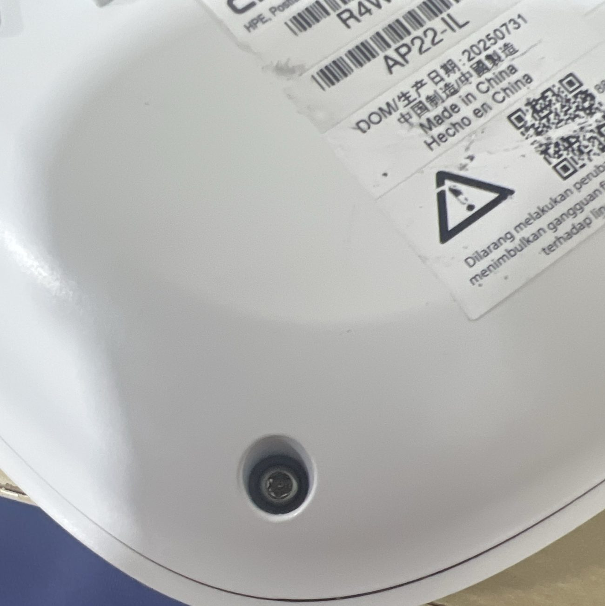
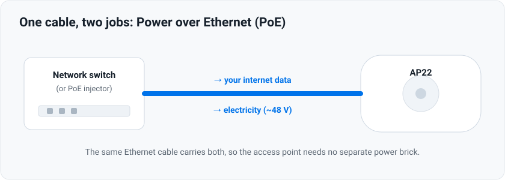
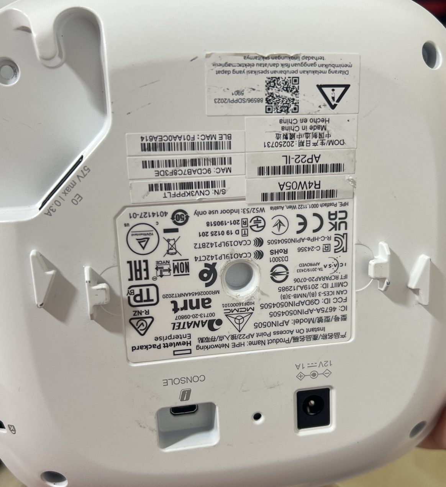
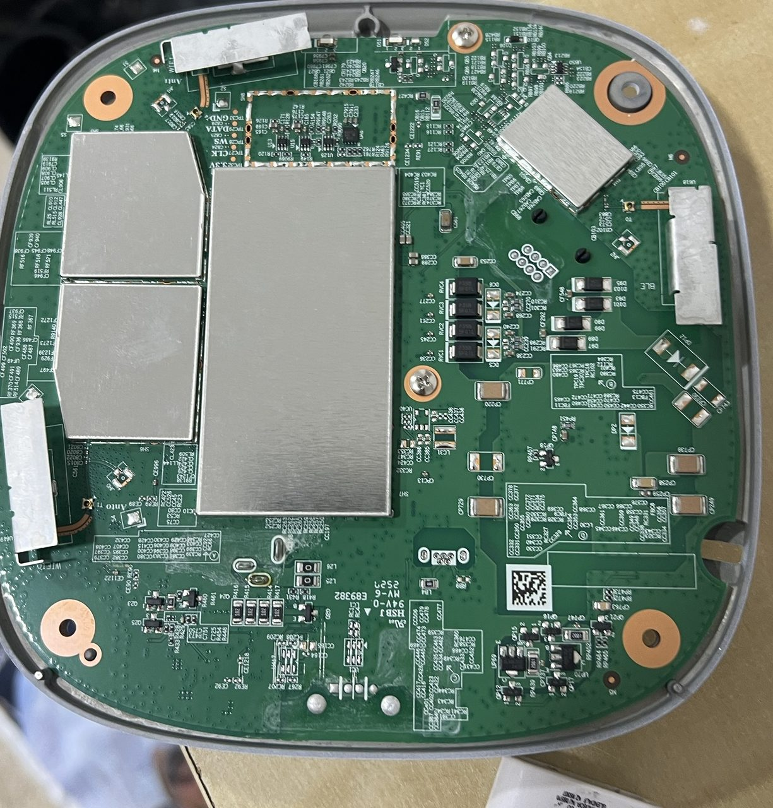
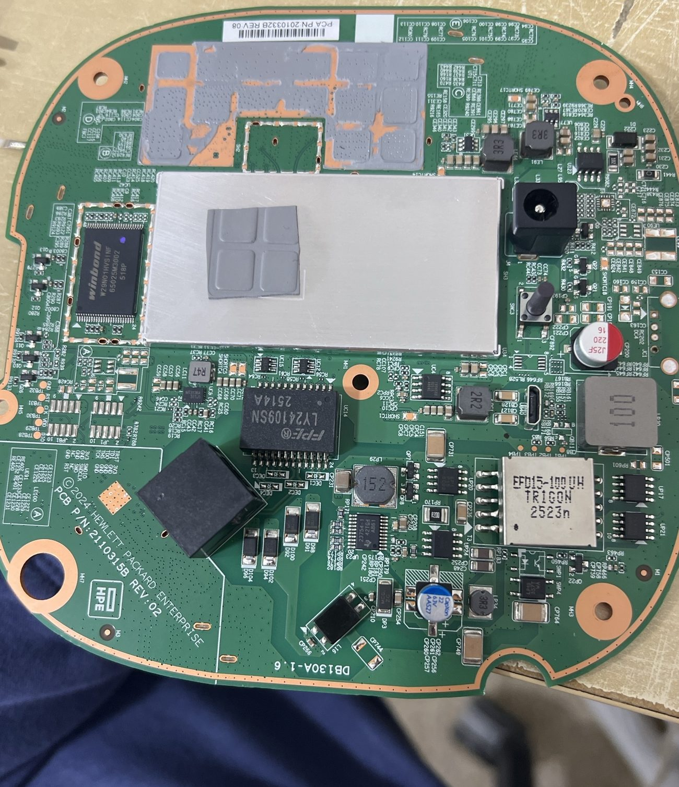
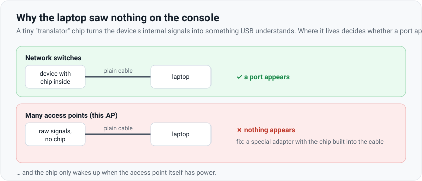
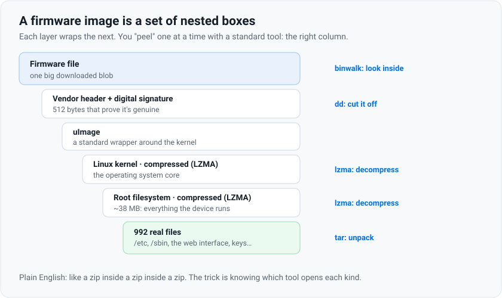
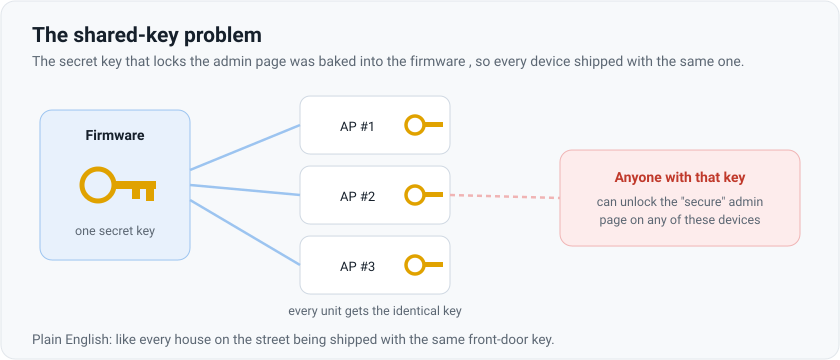

<div class="challenge-hero" markdown="0">
  
  <div class="challenge-hero-copy">
    <p class="challenge-eyebrow">Hardware teardown · APIN0505</p>
    <p class="challenge-prompt">What's inside, and can I get a shell on it?</p>
  </div>
</div>

It's late, there's a white plastic disc on my desk, and I can't get the screw out.

That's how most of my good evenings start. The disc is an HPE Networking Instant On AP22, one of those flat access points you've walked under a hundred times in offices without noticing. I didn't want to use it. I wanted to open it, read its guts, and see if I could talk to it the way an engineer would. By the end of the night I had it in pieces, a firmware image flayed open layer by layer, and a "vulnerability" older than some of my tools. This is the whole thing, including the hour I spent on the wrong device.

If a word stops you, there's a grey box nearby that unpacks it. Skip them if you already know the territory.

<aside class="callout callout-info">
<strong>In plain English: what is this thing?</strong>
An <em>access point</em> is the box that broadcasts Wi-Fi. Your phone talks to it through the air; it hands that traffic to the wired network and out to the internet. In offices they're the flat white discs on the ceiling. This one is HPE's "Instant On AP22."
</aside>

## The screw fights back

The AP22 keeps one screw tucked in a little well near the label, and it isn't the friendly cross-head you own a dozen bits for. It's a Torx, the six-pointed star, and on small gear like this it's often a security Torx, with a pin standing up in the middle so your ordinary bit won't bite.


Let me save you the mistake I nearly made. Don't bring a power drill to a screw this small. Steady pressure, the right bit, turn it slow. And know going in that the second you crack the case, the warranty is a memory.

## No battery. It eats through the cable.

Flip it over and the underside explains how it stays alive. There's a round 12 volt socket, a port marked CONSOLE, a pinhole reset, and the network port stamped E0, 57V max. That "57V" is the giveaway. This thing doesn't run on a battery and it doesn't need its own power brick. It drinks electricity straight from the network cable, a trick with the literal name Power over Ethernet.



Plug one cable into the right kind of switch and it blinks awake, green. No adapter in sight.



<aside class="callout callout-info">
<strong>In plain English: wait, no battery?</strong>
None. Your phone stores power; this never does. Pull the cable and it's instantly, completely dead. Everything inside only lives while that one wire feeds it.
</aside>

## Inside, where the city is

Four screws later the case gives up and I'm looking at the board. First reaction, honestly: is one of those silver rectangles a battery? They're not. They're little metal roofs soldered over the touchiest chips to keep them from whispering interference into the radios. The foil-wrapped slabs around the rim are the antennas.



<aside class="callout callout-info">
<strong>In plain English: reading a circuit board.</strong>
It helps to see it as a tiny city. A handful of important buildings do the real work: one is the brain, one is the long-term memory, one runs the power plant. The hundreds of little specks around them are plumbing that steadies the electricity and carries messages between the big players.
</aside>

Turn the board over and the characters that carry the rest of this story show up:

- A Winbond chip: the flash memory, the device's permanent store. This is where the firmware sleeps. 128 MB of it.
- The big shield with a grey pad: the brain sits under there, and the pad wicks its heat out into the metal case.
- A black cube and an FPE block: the network socket and its electrical moat.
- A chunky EFD15 TRICON: the part that tames the ~50 volts off the cable down to the small voltages the chips want.



## The console that wouldn't answer

Here's where I thought the night would get easy. Gear like this almost always has a serial console, a plain-text back channel engineers use to watch it boot and type low-level commands. You connect at a set speed, hit a key during start-up, and drop into the bootloader before the real system takes over.

I wrote a little script to do exactly that and ran it. The Mac shrugged. No device. Nothing to even connect to.

<aside class="callout callout-info">
<strong>In plain English: a serial console?</strong>
It's an old, simple maintenance line, older than Wi-Fi or any web page. Think of the diagnostic port a mechanic plugs into under your dashboard. You don't use it day to day. It shows what's really happening underneath.
</aside>

The reason it stayed silent is a small, stubborn detail. That port needs a tiny translator chip to turn the device's internal chatter into something a USB port can read. On a lot of access points, that chip doesn't live in the device at all. It lives inside a special cable you're expected to own.



<aside class="callout callout-warn">
<strong>Two different ways to get nothing.</strong>
Either the translator chip hides in the special <code>AP-CBL-SERU</code> cable instead of the AP, so an ordinary cable shows no device, or the chip isn't powered, because it only wakes when the AP does. Each one alone gives you the same empty screen. I'd managed to line up at least one of them.
</aside>

So the console slammed shut until I get the right adapter. Fine. The firmware was a download away, so I went in through the software door.

## Firmware is a set of nested boxes

<aside class="callout callout-info">
<strong>In plain English: what's firmware?</strong>
Firmware is the built-in software that makes a device <em>be</em> that device, the program baked into the memory chip that runs the instant you power it on. The maker ships it as one file. Open that file and it's boxes inside boxes inside boxes.
</aside>

I fed the image to binwalk, a tool that reads through a file and names the shapes it finds. And there they were, the nested boxes. The whole trick, it turns out, is knowing which tool cracks each layer:



In practice it's a slow, satisfying unwrapping. binwalk points at a 512-byte vendor header bolted to the front:

```text
$ binwalk ArubaInstant_Hercules_6.5.0.0-4.3.0.2_57688

512   0x200   uImage firmware image, CPU: ARM, OS: Linux,
              image type: OS Kernel Image, image name: "Linux-3.4.103"
```

I slice that header off and look again. The operating system inside is compressed. A "Code Signing" marker tells me the image is signed, the manufacturer's tamper-proof wax seal. Two lines of Python melt the compression away:

```bash
python3 -c 'import lzma; open("kernel.elf","wb").write(
  lzma.LZMADecompressor(format=lzma.FORMAT_ALONE).decompress(
  open("kernel.lzma","rb").read()))'
```

Nested inside that is a second, fatter compressed blob, about 38 MB, the root filesystem, the whole set of files the device lives in. Unpack it and you're finally holding the real thing:

```text
$ file rootfs.bin
rootfs.bin: ASCII cpio archive (SVR4 with no CRC)   <- an archive of 992 files
```

<aside class="callout callout-warn">
<strong>The ten minutes I'd like back.</strong>
On a Mac, the built-in <code>cpio</code> refuses to unpack files with absolute paths and does nothing at all, cheerfully. Use <code>tar -xvf rootfs.bin</code> instead and it all spills out. It fails silently, which is the worst kind of bug.
</aside>

Then the folder fills: start-up scripts, the programs that run it, the web interface. A whole miniature Linux laid out on my disk.

## Hunting for the soft spot

<aside class="callout callout-info">
<strong>In plain English: what am I even looking for?</strong>
Two classic slip-ups: a <em>password</em> written straight into the code, or a <em>secret key</em> (the digital version of a house key) stamped into every unit that ships. Find either, and you've found a way past the lock.
</aside>

Most of what I turned up was noise. Then one line of output sat up and looked at me. The device's web interface was shipping with its secret key sitting right there in the firmware.

```text
$ grep -c 'PRIVATE KEY' aruba/conf/instant_webui.pem aruba/conf/mini_httpd.pem
aruba/conf/instant_webui.pem:2
aruba/conf/mini_httpd.pem:2
```

That key is supposed to prove the admin page really belongs to this device and to scramble your connection to it. If every unit carries the same one, the protection is mostly theatre:



For about thirty seconds, I felt clever.

## The twist, in two parts

Then I did the thing you always do before you get excited. I checked whether anyone had been here first. Two answers came back, and the second one is the real story.

The first: my shiny find is a 2016 classic. A researcher at SEC Consult pulled this exact key out of Aruba firmware nearly a decade ago, the vendor owned up to it, and it's been in the public record with its own ID numbers ever since (CVE-2016-2031 and CVE-2016-2032). I hadn't found a crack in the wall. I'd rediscovered a plaque on it.

The second cut closer. I'd been taking apart the wrong firmware all night. The image I downloaded was the older product line, an 802.11ac generation from 2016, its operating system dated to match. The disc on my desk is a newer Wi-Fi 6 Instant On box that runs something else. Every careful layer I peeled belonged to a different machine. I'd picked the lock on the wrong door and admired the wrong room.

<aside class="callout callout-info">
<strong>The bug that actually belongs to this device.</strong>
When I went looking for the AP22's <em>real</em> firmware, I found CVE-2025-37103: a hard-coded administrator password baked into HPE Instant On access points running firmware 3.2.0.1 and earlier. Anyone who knows it walks straight in as admin. It's scored 9.8 out of 10, about as bad as the scale goes. The fix is almost anticlimactic: update to 3.2.1.0 or later. There's no workaround, and the Instant On switches are untouched.
</aside>

The real prize after all that dissection was almost embarrassing. The one piece of advice that matters if you own one of these: open the Instant On app, check your firmware version, and update it.

## What I'd tell myself at the start of the night

- Match the firmware to the hardware before you fall in love with it. A codename and an operating-system date would have saved me an hour. "Instant" and "Instant On" are different families wearing similar names.
- The method travels even when the target doesn't. Scan, strip the header, decompress the system, find the filesystem, unpack it. That same sequence opens a startling range of smart-home and network gear.
- Rediscovering a known bug still means the method works. Check prior art before you celebrate. If something really is new, send it to the vendor in private instead of posting it.
- Work out how a console port is wired before you buy cables. A chip inside the device and a chip inside the cable are different purchases.
- Then do the boring thing you came to tell everyone else to do: find the version, patch the version.

## Mini-glossary

- Access point: the box that broadcasts Wi-Fi and bridges it to the wired network.
- PoE (Power over Ethernet): electricity and data riding the same network cable.
- Firmware: the built-in software that makes a device work, living on its memory chip.
- Flash memory: the chip that keeps firmware and settings even with the power off.
- Serial console: a simple text channel for watching a device boot and running low-level commands.
- binwalk: a tool that scans a file and names the known pieces packed inside it.
- Private key: a secret that proves identity and scrambles a connection. It's only safe while it stays unique and unshared.
- CVE: a public catalogue number for one specific, known security flaw.
